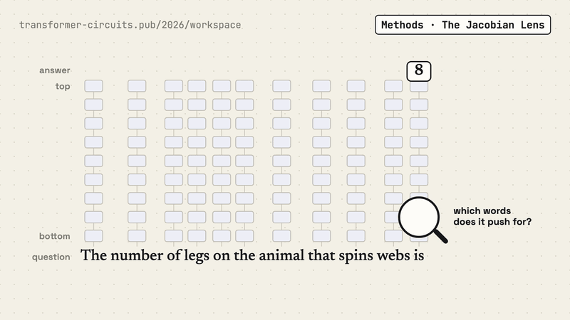
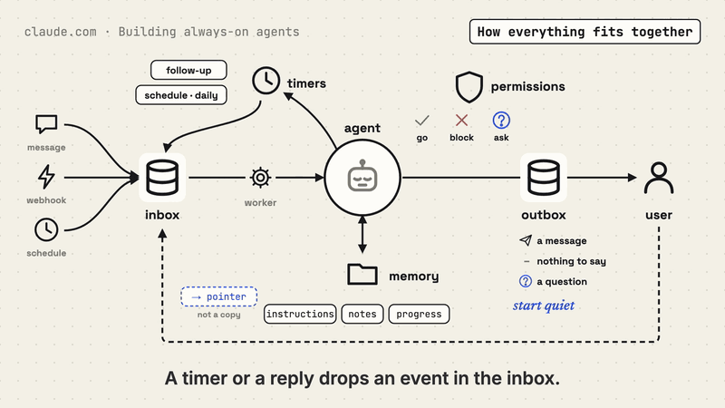

# papertalk

Give it a paper, a blog post or a post on X. Get back a 1–2.5 minute explainer video, 16:9, where the picture shows exactly what the voice is saying.

<p>
  
  
</p>

Claude Code does the reading and the writing. papertalk does the rest: it fetches the source, voices the script, times every word, draws and animates the picture, checks every frame for overlapping text and renders the video.

No API keys needed: the thinking runs on your Claude subscription and the voice is generated on your machine. With an ElevenLabs key, the voice sounds more natural.

## Install

In Claude Code (v2.1.275 or later), one command:

```
/plugin install papertalk --marketplace AmirMakir/papertalk
```

Choose **Install for you**. Claude Code then asks three things: which voice (free on your computer, ElevenLabs, or your own voice files), your ElevenLabs key if you picked it (kept in the system keychain, never in a file or the chat), and the folder for your videos (`~/papertalk` if you leave it empty). To change them later: `/plugin` → **Installed** → papertalk → **Configure options**.

Then, in any folder:

```
/papertalk:explain https://arxiv.org/abs/1706.03762
```

The first run installs the engine once: Remotion and the free voice, about 1 GB, 1–3 minutes. It needs Node 20 or later.

Claude reads the source and shows you the main idea, the picture it plans and the script. After your OK it makes the voice and the storyboard, checks every frame and shows you contact sheets. After your second OK it renders the video and writes a post to go with it. It takes about 10–15 minutes. Say "no stops" to skip both questions.

To update: `/plugin` → **Installed** → papertalk → **Update now**, or turn on auto-update for the papertalk marketplace under `/plugin` → **Marketplaces**.

### From a clone, to change the code

```bash
git clone https://github.com/AmirMakir/papertalk && cd papertalk
npm install
claude --plugin-dir .
```

The plugin then loads from your folder, and videos go into `videos/` and `out/` inside it. The first `/papertalk:explain` asks which voice to use.

## What makes the videos clear

- **One picture for the whole video**, built from the source's own example. Every point happens on it: something lights up, moves, gets swapped or switched off.
- **The picture changes on the word that names the change.** Timings come from the voice itself, word by word.
- **A term appears only once its thing is on screen.**
- **No formulas or bullet lists where something can be shown.** One caption line, because feeds autoplay muted.
- **Facts only from the source**, each with its place in it, credited and linked on screen.

The full rules are in [the skill](skills/explain/SKILL.md).

## Sources

| Source | How |
|---|---|
| arXiv | its HTML version (most papers since late 2023) |
| Research sites, blogs, essays | the readable part of the page |
| A post on X | X's public embed, no login |
| X threads and Articles | need a login: paste the text into a `.md` file and give Claude the file |
| Your files | `.md`, `.txt`, `.html`, `.pdf` (PDF needs `pdftotext` from poppler) |

Only the page text is fetched. Images stay as links.

## By hand, without Claude

```bash
node scripts/papertalk.mjs ingest <name> <link or file>   # videos/<name>/source.md + outline
# write videos/<name>/script.txt and storyboard.json (see docs/)
node scripts/papertalk.mjs voice <name>                   # the voice chosen at setup
node scripts/papertalk.mjs check <name>                   # overlap report + contact sheets in out/
node scripts/papertalk.mjs render <name>                  # out/<name>.mp4
```

Voice: `node scripts/papertalk.mjs setup --voice local am_michael` (or `af_heart` and other [Kokoro](https://huggingface.co/hexgrad/Kokoro-82M) voices), `--voice eleven` with `ELEVENLABS_API_KEY` in `.env`, or `--voice files` for WAVs from any TTS. `node scripts/papertalk.mjs sample am_michael,af_heart` writes samples to listen to.

## In other MCP clients

```bash
claude mcp add papertalk -- node /absolute/path/to/papertalk/mcp/server.mjs
```

The plugin starts this server for you. Other MCP clients, such as Cursor or Claude Desktop, can run it from a clone and get the same steps as tools: `papertalk_guide` (the rules), `papertalk_setup`, `papertalk_ingest`, `papertalk_write`, `papertalk_voice_text`, `papertalk_voice`, `papertalk_check`, `papertalk_render`.

## How it fits together

```
source ──ingest──▶ source.md ──Claude──▶ facts.md, script.txt
                                              │
                               voice ─────────┴──▶ voice.wav + every word's time
                                                          │
                                        Claude ──▶ storyboard.json (+ picture.svg)
                                                          │
                                   check: frames + overlap report ──▶ render ──▶ out/<name>.mp4
```

```
src/kit/          the picture: sentence row, arcs, tower and lens, bars, diagrams, svg, the frame checker
scripts/          papertalk.mjs (one entry point), ingest, voice (+ word aligner, local TTS), make (check and render), doctor, sound effects
skills/explain/   the Claude Code skill: rules, steps, two stops
.claude-plugin/   plugin manifest (settings, MCP server) and the marketplace entry
mcp/server.mjs    the same steps as MCP tools
docs/             storyboard and SVG reference, formats for papers, essays and posts
examples/         finished scripts, storyboards and facts
videos/<name>/    your work in a clone (git-ignored); the plugin uses ~/papertalk
```

## Licences

papertalk's code is MIT. Rendering uses [Remotion](https://www.remotion.dev/license): free for individuals and companies of up to three people, while larger companies need a Remotion company licence. The local voice is Kokoro-82M (Apache-2.0). Fonts are Google Fonts under the Open Font License. Sound effects are generated by `scripts/sfx.mjs`, with no samples.

The videos explain other people's work: credit the authors, link the source, quote briefly, and don't present the video as coming from them.
